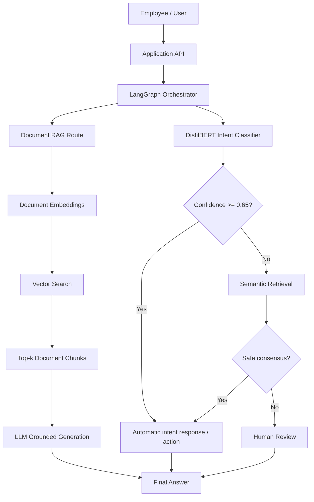
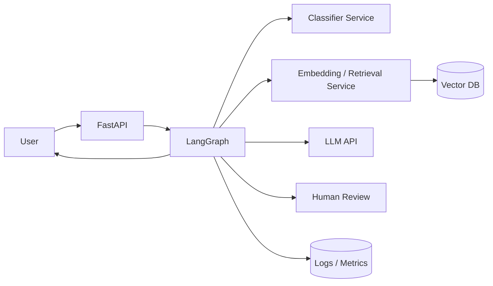

# ML System Design

## Интеллектуальный ассистент для поддержки сотрудников

Система предназначена для автоматической обработки типовых запросов сотрудников, классификации намерений, поиска информации во внутренних документах и формирования ответов с возможностью передачи сложных случаев человеку.

---

# 1. Постановка задачи

Необходимо разработать интеллектуального ассистента, который отвечает на вопросы сотрудников по внутренним документам, регламентам, продуктам и инструкциям.

Система должна не только выдавать ответ, но и определять тип запроса, находить релевантную информацию, проверять достаточность уверенности и при необходимости передавать запрос на ручную обработку.

Целевая логика обработки:

`определение типа запроса → поиск информации → дополнительный поиск при необходимости → проверка ответа → финальный результат`

---

# 2. Бизнес-цель

Сократить количество типовых обращений, которые требуют ручной обработки специалистом, при сохранении контролируемого качества автоматических ответов.

Основные бизнес-эффекты:

- сокращение нагрузки на сотрудников поддержки;
- уменьшение времени ответа;
- единообразие ответов по внутренним документам;
- автоматическая эскалация сложных запросов;
- накопление данных для дальнейшего улучшения системы.

---

# 3. Пользователи системы

Основные пользователи:

- сотрудники компании;
- специалисты внутренней поддержки;
- операторы, которые получают запросы на human review;
- ML / Data-команда, сопровождающая систему.

---

# 4. Функциональные требования

Система должна:

1. Принимать текстовый запрос пользователя.
2. Определять intent запроса.
3. Возвращать confidence классификатора.
4. Использовать reject threshold для неуверенных запросов.
5. Выполнять semantic retrieval.
6. Искать релевантные фрагменты внутренних документов.
7. Формировать grounded RAG-ответ.
8. Маршрутизировать запросы через orchestration layer.
9. Передавать недостаточно уверенные случаи человеку.
10. Логировать предсказания, confidence и маршрут.
11. Поддерживать обновление документной базы.

---

# 5. Нефункциональные требования

### Качество

Для автоматически закрываемых intent-запросов целевой уровень automatic accuracy: **не ниже 95%**.

### Надёжность

При недостаточной уверенности запрос не должен автоматически закрываться и направляется на human review.

### Latency

Классификационный маршрут должен работать быстрее RAG-маршрута. LLM вызывается только там, где действительно требуется генерация.

### Безопасность

API-ключи и служебные credentials не должны храниться в GitHub-репозитории.

Document RAG должен формировать ответы только на основе найденных внутренних документов.

---

# 6. Архитектура системы

В экспериментальной конфигурации дополнительная low-confidence consensus-ветка не дала безопасного прироста coverage при SLA >=95% automatic accuracy.

Поэтому финальная frozen-policy фактически использует DistilBERT + reject threshold как основной безопасный маршрут.

---

# 7. Основные компоненты

## 7.1 Intent Classifier

Модель: `distilbert-base-uncased`

Количество классов: **77**

Количество эпох обучения: **6**

Confidence threshold: **0.65**

Назначение:

- определение intent;
- выдача confidence;
- принятие решения об auto-close или escalation.

## 7.2 Semantic Retrieval

Embedding model: `sentence-transformers/all-MiniLM-L6-v2`

Retrieval corpus строится только по `train_part`.

Используется для:

- поиска похожих пользовательских запросов;
- дополнительной проверки low-confidence classification;
- retrieval-метрик Hit@K.

## 7.3 Document RAG

Основные этапы:

1. Разбиение документов на chunks.
2. Построение embeddings.
3. Vector similarity search.
4. Получение top-k chunks.
5. Формирование grounded prompt.
6. Генерация ответа LLM.
7. Возврат ответа вместе с источниками.

Evaluation generator model: `openai/gpt-oss-120b`

## 7.4 LangGraph

LangGraph используется как orchestration layer для маршрутизации запросов между ML-компонентами.

Его задача — управлять workflow, а не обязательно улучшать accuracy сам по себе.

---

## 7.5 Реализованный LangGraph workflow

После подготовки MLSD orchestration layer был реализован
как исполняемый LangGraph workflow.

Граф включает следующие узлы:

- `determine_query_type`;
- `classify_intent`;
- `semantic_retrieval`;
- `check_intent`;
- `document_retrieval`;
- `generate_answer`;
- `validate_answer`;
- `additional_search`;
- `validate_after_additional_search`;
- `human_review`;
- формирование финального ответа.

Smoke-test проверил четыре ключевых сценария:

1. high-confidence intent → auto resolution;
2. low-confidence intent → human review;
3. Document RAG → direct success;
4. Document RAG → additional search → success.

Все сценарии успешно прошли.

Результат сохранён в:

`results/langgraph_smoke_test.json`

Таким образом, LangGraph в текущем репозитории является
не только design-компонентом, но и реально реализованным
исполняемым orchestration layer.

---

## 7.6 Structured Output

Для стандартизации ответа системы реализован
schema-enforced Structured Output на базе Pydantic v2.

Основные схемы:

- `IntentResult` — результат intent classification;
- `RAGSource` — metadata источника Document RAG;
- `AssistantResponse` — единый финальный ответ системы.

В `AssistantResponse` фиксируются:

- тип запроса;
- выбранный route;
- финальный answer;
- необходимость human review;
- intent result;
- список RAG sources.

Pydantic validation не позволяет вернуть:

- неизвестный route;
- confidence вне диапазона 0..1;
- пустой answer;
- некорректную структуру результата.

Structured Output был проверен smoke-test:

`results/structured_output_smoke_test.json`

Все проверки завершились успешно.

---

## 7.7 Tool Calling

В проект добавлен минимальный исполняемый Tool Calling layer.

Он включает:

- внутренний tool registry;
- Pydantic-схемы аргументов;
- проверку существования tool;
- безопасный executor;
- JSON-совместимый ответ;
- metadata доступных tools для router/LLM.

Реализованы два демонстрационных инструмента:

- `get_account_status`;
- `get_product_info`.

Оба инструмента используют mock internal services,
поэтому они демонстрируют механизм Tool Calling,
но не подключены к реальной production CRM.

В production registry может быть расширен tools для:

- CRM;
- внутренних справочников;
- статуса заявок;
- продуктового каталога;
- внутренних workflow/API.

Smoke-test:

`results/tool_calling_smoke_test.json`

Все проверки завершились успешно.

---

# 8. Данные

### Banking77

- train_part: **8494**
- val_part: **1499**
- test: **3076**

Количество классов: **77**

Разделение:

- train_part — обучение моделей и retrieval corpus;
- val_part — threshold и architecture selection;
- test — только финальная оценка.

### Document RAG data

Отдельная коллекция внутренних документов разбивается на semantic chunks.

Для независимой RAG-оценки использовано **30** API-generated QA-примеров.

---

# 9. Training pipeline

1. Загрузка Banking77.
2. Формирование train / validation / test.
3. Обучение DistilBERT на train_part.
4. Evaluation после каждой эпохи на val_part.
5. Выбор лучшего checkpoint по Macro F1.
6. Построение semantic retrieval corpus.
7. Получение validation predictions.
8. Sweep confidence threshold.
9. Выбор threshold при automatic accuracy >=95%.
10. Проверка LangGraph architecture на validation.
11. Freeze всех параметров.
12. Однократная final test evaluation.

---

# 10. Online inference flow

### Intent-запрос

`request → preprocessing → DistilBERT → confidence gate`

Если confidence >= 0.65, intent принимается автоматически.

Если confidence ниже, запрос может пройти дополнительную retrieval-проверку или быть передан человеку.

### Document-запрос

`request → embedding → vector search → top-k chunks → LLM generation → answer`

Если подходящего контекста недостаточно, система должна отказаться от уверенного ответа или передать запрос на ручную обработку.

---

# 11. Offline metrics

## Intent classification

- Test Accuracy: **92.56%**
- Test Macro F1: **92.55%**

## Semantic retrieval

- Hit@1: **91.42%**
- Hit@3: **95.48%**
- Hit@5: **96.72%**

## Selective classification

- Coverage: **93.95%**
- Automatic accuracy: **95.22%**
- Human review rate: **6.05%**

## Document RAG

- Source accuracy: **96.67%**
- Answer accuracy: **93.33%**
- Groundedness: **76.67%**
- Overall RAG success: **76.67%**

---

# 12. Online metrics

Для production-системы необходимо мониторить:

- request volume;
- p50 / p95 latency;
- auto-resolution rate;
- human review rate;
- human override rate;
- low-confidence rate;
- no-answer rate;
- RAG retrieval failure rate;
- LLM/API error rate;
- intent distribution drift;
- confidence distribution drift;
- document freshness.

---

# 13. Production deployment

Предлагаемая production-архитектура:

- FastAPI — внешний API;
- Docker — упаковка сервисов;
- DistilBERT inference service;
- embedding service;
- vector database: FAISS для prototype или Qdrant для production;
- LangGraph orchestration service;
- LLM API provider;
- PostgreSQL / log storage;
- monitoring stack;
- human-review interface.

---

# 14. Monitoring

Необходимо контролировать:

- Accuracy по размеченным production-примерам;
- изменение confidence distribution;
- рост human review rate;
- изменение частоты intents;
- retrieval similarity distribution;
- процент RAG-ответов без релевантного источника;
- hallucination / groundedness signals;
- latency и API failures.

---

# 15. Retraining strategy

Источники новых данных:

- human review;
- исправленные ответы операторов;
- новые типы запросов;
- новые документы;
- production logs.

Предлагаемый цикл:

1. Сбор новых размеченных запросов.
2. Data quality check.
3. Обновление train corpus.
4. Retraining.
5. Validation threshold selection.
6. Offline comparison с текущей production-моделью.
7. Shadow / canary deployment.
8. Production rollout при прохождении quality gate.

---

# 16. Обновление документной базы

Document RAG не требует переобучения intent-классификатора при каждом обновлении документа.

При изменении внутренних документов:

1. Загружается новая версия документа.
2. Документ повторно разбивается на chunks.
3. Пересчитываются embeddings изменённых chunks.
4. Vector index обновляется.
5. Старая версия документа архивируется.
6. Выполняется retrieval smoke-test.

---

# 17. Риски

| Риск | Механизм снижения |
|---|---|
| Неверная intent-классификация | Confidence threshold + human review |
| Overconfidence | Selective classification и мониторинг confidence |
| Hallucination RAG | Grounded prompt + retrieval context + source tracking |
| Устаревшие документы | Versioning и регулярное обновление vector index |
| API outage | Fallback / human review |
| Data drift | Monitoring + periodic retraining |
| Утечка API keys | Secrets storage, .env и .gitignore |
| Рост latency | Кэширование и разделение быстрых и LLM-маршрутов |

---

# 18. Результат LangGraph-эксперимента

На validation была проверена гипотеза, что согласие DistilBERT и semantic retrieval позволит безопасно закрывать дополнительные low-confidence запросы.

Raw accuracy consensus-группы оказалась недостаточной для требуемого SLA.

После добавления similarity gate ни один дополнительный low-confidence запрос не мог быть безопасно закрыт при сохранении общей automatic accuracy >=95%.

Поэтому более сложная схема не была искусственно выбрана как лучшая. Финальная policy совпала с простым `DistilBERT + reject threshold` baseline.

LangGraph при этом остаётся полезным orchestration layer для объединения классификации, RAG, fallback и human review.

---

# 19. Возможные улучшения

- добавить cross-encoder reranker для Document RAG;
- перейти с in-memory/FAISS retrieval на Qdrant;
- использовать hybrid search: dense + BM25;
- внедрить structured output;
- добавить tool calling для внутренних сервисов;
- реализовать query rewriting;
- реализовать document versioning;
- добавить online feedback loop;
- добавить observability для LangGraph nodes;
- протестировать более сильный embedding model;
- расширить независимый RAG benchmark.

---

# 20. Итог

Разработанный prototype показывает, что система может автоматически обрабатывать большую долю запросов при контролируемом уровне качества.

На финальном test selective baseline автоматически закрывает **93.95%** запросов с automatic accuracy **95.22%**.

Document RAG показывает высокую точность ответов, но groundedness и overall success остаются основными направлениями улучшения.

Разделение train / validation / test и отдельный API-generated RAG benchmark позволяют избежать подгонки финальных метрик под evaluation dataset.